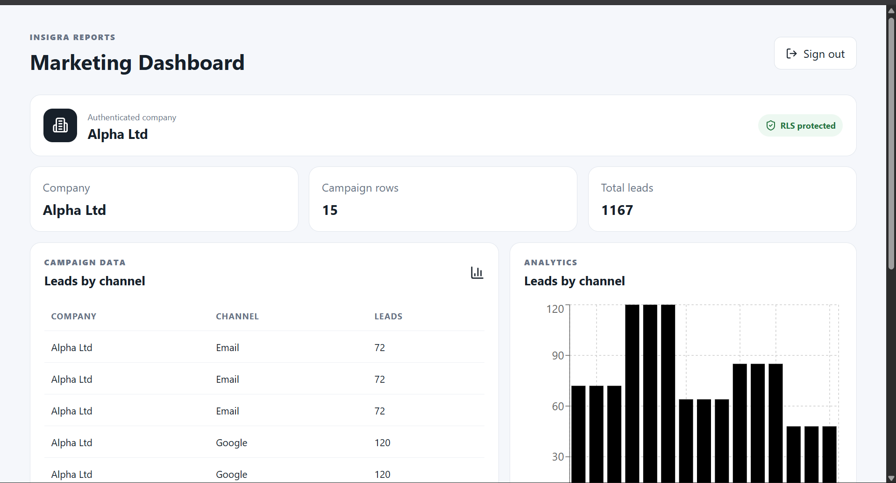
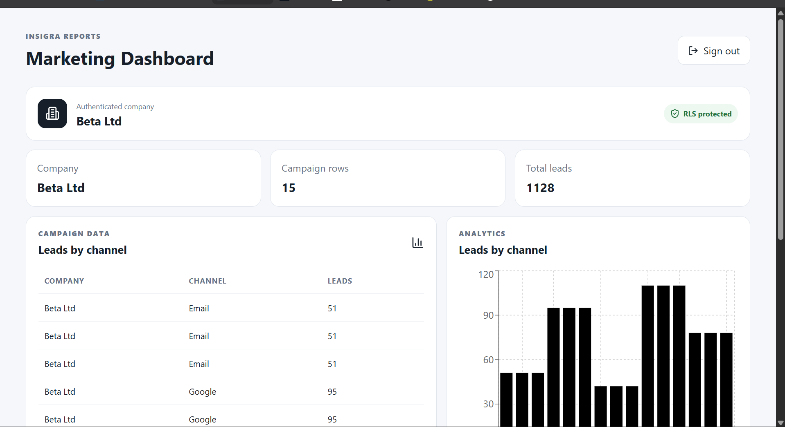

# Insigra Reports — Junior Developer Practical Task

React + TypeScript + Supabase Auth/PostgreSQL + Row-Level Security + Recharts.

## Assignment mapping
- Email/password login using Supabase Auth (JWT-backed session)
- `profiles`: maps Auth user ID to company
- `campaign_data`: Alpha/Beta marketing data
- PostgreSQL RLS: users can only read rows for their company
- Dashboard: table + leads-by-channel chart

## Run
1. Install Node.js 20+ (22 LTS recommended).
2. Run `npm install`.
3. Create a Supabase project.
4. In Supabase SQL Editor run `supabase/schema.sql`.
5. In Authentication → Users create `alpha@test.com` and `beta@test.com` with passwords.
6. Copy each Auth user's UUID and run `supabase/create-users.sql` after replacing the placeholders.
7. Copy `.env.example` to `.env.local` and fill `VITE_SUPABASE_URL` and `VITE_SUPABASE_ANON_KEY` from Supabase Project Settings → API.
8. Run `npm run dev` and open the Vite URL, usually `http://localhost:5173`.

## Screenshots

### Login Page



### Beta Dashboard



## Security
The key policy is:

```sql
create policy "Users can read their company campaign data"
on public.campaign_data
for select to authenticated
using (
  company_name = (
    select p.company_name from public.profiles p where p.id = auth.uid()
  )
);
```

Flow: Supabase Auth session/JWT → `auth.uid()` → `profiles.company_name` → RLS compares it with `campaign_data.company_name`. The frontend does not filter out other companies; PostgreSQL prevents those rows from being returned.

## Test
- Login as `alpha@test.com`: only 5 Alpha Ltd rows.
- Logout, login as `beta@test.com`: only 5 Beta Ltd rows.
- If either account sees the other company's rows, stop and fix RLS before submitting.

## Deploy
Run `npm run build`. Deploy the `dist` output to Vercel and add the same two `VITE_` environment variables. Configure Supabase Auth/site URL for the production URL if required.

## Submission
Provide the live URL, both test-user passwords, a 3-minute recording showing Alpha then Beta and explaining the RLS policy, plus 3 lines on difficulty/improvements.

Suggested reflection:
> The main challenge was designing the RLS policy so company isolation was enforced at the database layer rather than relying on frontend filtering. I verified it by signing in as both users and confirming each account only received its company's rows. With more time, I would add automated tests, stronger schema constraints, pagination, and a production-ready tenant management flow.

Never put a Supabase `service_role` key in the React frontend.
